# User-visible statechart

The reducer is synchronous and immutable. Animation completion is never a game event. Reconnect/pause is an outer room state; actions require the current revision. The only time transition is `advanceTime(state, now)`, with an injectable millisecond clock for unit tests. Server/solo schedule it at the power deadline; countdown painting cannot advance the game.

```mermaid
stateDiagram-v2
  [*] --> Lobby
  Lobby --> WaitingRoom: create / join
  WaitingRoom --> Setup: host starts, both connected
  Lobby --> Setup: solo vs memory bot
  Setup --> Setup: each privately looks at two once
  Setup --> Turn: both explicitly hide / ready
  Turn --> Drawn: private deck draw only
  Turn --> Turn: call, other gets one final turn
  Drawn --> Turn: replace / mismatch / non-power discard
  Drawn --> Stacking: discard drawn 7/8/9/10/J/Q
  Stacking --> Stacking: wrong rank rejected + one hidden deck card
  Stacking --> PowerTarget: 2500ms deadline, no stack; discarder acts
  Stacking --> PowerTarget: same-rank stack; discarder cancelled, stacker acts
  Turn --> Turn: ordinary same-rank non-power stack
  Turn --> PowerTarget: power stack from ordinary discard window
  PowerTarget --> Turn: J mandatory blind swap
  PowerTarget --> PrivatePeek: 7/8 own or 9/10 other
  PowerTarget --> QueenDecision: Q privately looks at chosen pair
  PowerTarget --> Turn: 7–10 skip, or J/Q no legal targets
  PrivatePeek --> Turn: explicit ack / Hide
  QueenDecision --> Turn: explicit swapDecision true or false
  Turn --> RoundEnd: final action complete / deck exhausted
  RoundEnd --> Setup: both request next round
  RoundEnd --> GameEnd: scoring meets match-end condition
  GameEnd --> Setup: unanimous rematch
  state Network {
    [*] --> Connected
    Connected --> Paused: disconnect
    Paused --> Connected: token resume within 30 seconds
    Paused --> Forfeit: deadline, other connected
    Forfeit --> Connected: unanimous rematch
  }
```

`Stacking` is `phase:'stacking'` with public `pendingPower:{actor,kind,deadline}` and `power:null`. Eligibility is strictly `now < deadline`; at or after the deadline stacks reject without penalty. The window is 2.5 seconds as a minimal provisional implementation choice, not a Wilson-confirmed duration. Wrong eligible ranks add one unseen deck card but preserve the deadline/top discard. Ineligible, self, stale, and nonexistent-slot attempts have no penalty. No reshuffle on empty deck; exhaustion waits through a pending power, otherwise scores after the rejected action completes.

`PowerTarget` uses a separate `powerActor` from the ordinary `active` player. A same-rank power stack cancels the pending discarder power and starts the stacker's power immediately, closing stacking. `PrivatePeek` and `QueenDecision` share `phase:'reveal'`. Only `powerActor` receives the private faces. Jack must swap if any pair exists; Queen must look then explicitly choose swap/keep. No timers hide private reveals or choose swaps.

A transferred drawn-card power completes the original ordinary turn once, including caller/final-turn accounting. A power stacked during an ordinary window is an interruption; it resumes that existing ordinary turn rather than granting or consuming a new turn. Non-power alternating chains retain their earlier provisional behavior. Power chains are not introduced; self-stacking, duration and chain interpretation remain questions in RULES.md.

Round scoring happens once after the final power/reveal decision, or the complete non-power action. Hands preserve stable slots; no card IDs, deck order, RNG or hidden faces cross the filtered view. Chat changes room metadata, never phase or revision. The celebration URL still simulates a finite genuine match, explicitly advancing pending deadlines without changing visual design.
