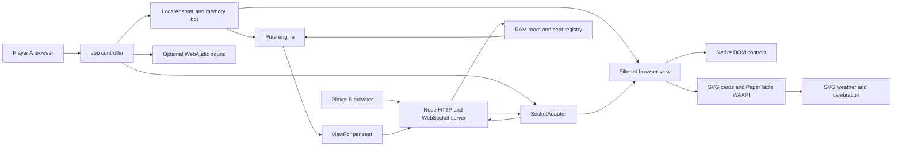
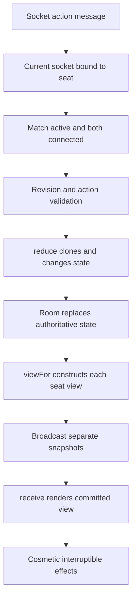

# P2 — Cabo: technical breakdown

**Rename note:** Cabo, formerly LOWKEY, follows Wilson's 23:21 directive. Current title, metadata and wordmark use Cabo; some internal identifiers and older owner records retain the earlier brand. [^final-style] [^entry] [^package]

## 1. Scope and implementation status

IMPLEMENTED: the final prototype uses one seeded CABO engine for local memory-bot play and authoritative two-seat WebSocket rooms. The browser renders a filtered view through native DOM/SVG controls and interruptible Web Animations API motion. An original SVG environment supplies weather and match celebration, not rule authority. Current evidence is in `analysis/p2-prototype/`; archives are historical only. [^engine] [^transport] [^scene] [^environment]

TESTED-REPORTED: the rules handoff is dated 23:17 and the final environment handoff 23:47. Re-run by documentation agent: **no**. Read-only inspection and `wc -l` measurements are documentation checks, not application verification. The feature agents protected these two documents, so their former rebuild status was stale. [^verified] [^env-ready] [^final-style] [^docbrief]

## 2. Final capabilities and Wilson's directives

The 22:17 optional-activation assignment is superseded by Wilson's 22:52 correction, not retained as a second rule profile. Stacking assumptions are separately labelled below. [^items] [^rules] [^rule-delta]

| Capability in final source | Status label | Evidence and limit |
| --- | --- | --- |
| Pure seeded rules reducer and typed errors | IMPLEMENTED | `createGame`, `validateAction`, `reduce`, `viewFor`, `assertState`; runtime JS, not TypeScript. [^engine] |
| Standard 52-card deck and opaque IDs | IMPLEMENTED | A1, J11, Q12, red K−1, black K13; no Jokers/zeros/Kamikaze; IDs never enter filtered views. [^engine] [^rules] |
| Deck-only draw and automatic power discard | IMPLEMENTED | Draw rejects other sources; `discard` has no `usePower` field. Exchange never activates powers. [^engine] [^rule-delta] |
| 7/8 own peek, 9/10 other peek, J/Q distinction | IMPLEMENTED | J mandatory blind swap if a pair exists; Q selected-pair private look then explicit boolean swap/keep. Reveals have no timer. [^rules] [^engine] |
| Authoritative same-rank stacking | IMPLEMENTED | Other-player top discard, occupied own slot, public success/hole, no turn change; power/window/penalty choices remain assumptions. [^rules] |
| Quick and Classic scoring | IMPLEMENTED | Four rounds without reset versus >100 ending/one-time exact-100 reset. [^engine] [^rules] |
| Local memory bot and rematch | IMPLEMENTED | LocalAdapter passes filtered observations to `createBot`; local authority remains inspectable in browser. [^transport] [^engine] |
| Actual two-seat network rooms | IMPLEMENTED | Node HTTP/ws, create/join/start, filtered broadcast, rematch. [^server] |
| Reconnect, pause and disconnect forfeit | IMPLEMENTED | Seat-token resume; default 30-second deadline; room state lives in RAM. [^server] |
| SVG poker faces and DOM/WAAPI table | IMPLEMENTED | `PaperTable`, crisp mirrored indices/pips/courts/backs, power footers, avatars outside card rows; no WebGL requirement. [^cards] [^scene] [^entry] |
| Waterside environment and celebration | IMPLEMENTED | Seeded wide/pocket SVG, rain/call/end mood, animals/sun, 26 transient confetti paths and static reduced-motion fallback. [^environment] |
| Clean genuine seeded celebration replay | IMPLEMENTED | `/?demo=celebrate` locally reduces a four-round match; optional `seed=2252`; no fabricated winners or network claim. [^scene] |
| Bounded plain-text table chat | IMPLEMENTED | Online-only, 280 characters, 50 latest messages, 700ms interval; not E2EE. [^server] [^app] |
| Keyboard, motion settings, optional sound | IMPLEMENTED | Native handlers, local settings and WebAudio; no independent assistive-device certification. [^app] [^audio] |
| Final rule and visual evidence | TESTED-REPORTED | 42 Node tests; 16 ws, 22 network Chromium, 48 focused, 7 solo; later 136 environment assertions/24 captures and repeat 42 + 7. [^verified] [^env-ready] |
| Durable Objects port and durable receipts | PROPOSED | Archived README sketches adapter migration; no final deployment/code here. [^historic-readme] |
| Accounts, matchmaking, public deployment, 3+ seats | DEFERRED | Owner's explicit non-features. [^readme] |

### Wilson's directives that shaped this problem

Times are the +08 chat times supplied to this refresh; saved files support the resulting requirements/implementation, not a complete chat transcript. Chat outweighs earlier markdown. [^refresh]

| Directive time | Consequence and evidence | Status label |
| --- | --- | --- |
| 21:5x, then 22:21 | Earlier Q2 benchmark replaced by Q7/Architecture Magic scale/craft, not its identity. [^cloud] [^final-style] | IMPLEMENTED |
| 22:00 / 22:17 | Recognisable poker cards with powers; final standard deck/King/J/Q semantics, no Jokers/Kamikaze. [^items] [^rules] [^cards] | IMPLEMENTED |
| 22:18 | Unfold hand-drawn SVG direction replaces earlier 3D runtime. [^cloud] [^final-style] [^vendor] | IMPLEMENTED |
| 22:41 | Hub-v3 kit informs large actions, competing-choice hover fade and under-word highlights. [^final-style] | IMPLEMENTED |
| 22:52 | Deck-only draws, automatic powers and other-player same-rank stacking; daniildesigns before/after environment reference adapted to original waterside SVG. [^rule-delta] [^video-notes] | IMPLEMENTED |
| 23:09 | Match-end ink celebration, cheering animals and rain-to-sun change. [^final-style] [^environment] | IMPLEMENTED |
| 23:12 | humans& anchor: restrained reveals/recognisable mascots; proposed dissolve/winner accent not verified here. [^humans] | PROPOSED |
| 23:21 / 23:33 | Cabo rename; every graphic reflects the product, including visible face power footers. [^final-style] [^entry] [^cards] | IMPLEMENTED |
| 200–400k context rule | Not a runtime capability: no live model is called. Builder-context compliance is unknown. [^refresh] [^engine] [^server] | UNKNOWN |

## 3. Architecture

IMPLEMENTED: `client/app.mjs` chooses LocalAdapter or SocketAdapter. The local adapter holds full authority locally; the socket adapter sends only actions plus the observed revision. Server rooms hold full multiplayer state and call `viewFor` separately for each seat before broadcast. Scene and sound are presentation modules, not rule authorities. [^app] [^transport] [^server]



Diagram status: IMPLEMENTED; the shared engine appears in two execution locations, browser local adapter and Node authoritative server, not as one shared network process. [^engine] [^transport] [^server]

IMPLEMENTED: the network transition below separates room/session checks from reducer phases. No generated-code sandbox, runtime LLM or database sits on this path. Chat uses the same seat-bound connection but does not advance the game revision. [^server] [^engine]



Diagram status: IMPLEMENTED; rejected ordinary commands produce an error and filtered broadcast, not a transition or replay receipt. Rejected stack actions are the deliberate exception: private error only, no opponent packet or state mutation. [^server] [^integration-script]

## 4. Data and control flow: main two-player path

1. IMPLEMENTED: `client/index.html` loads local styles and `app.mjs`, not Three/GSAP. `updateRulesCopy()` corrects the retained raw dialog text at startup. `online(command)` constructs SocketAdapter; `connect()` opens same-host `/ws`, selecting ws or wss from page protocol. [^entry] [^app] [^transport]
2. IMPLEMENTED: the Create/Join handlers send name, room code and mode, not full state. `startServer` creates room maps and random seat tokens; `attach` binds one active socket to the seat and replaces an old one. [^app] [^server]
3. IMPLEMENTED: `onSession` stores `{code, playerId, token}` under `callit-seat-<code>` in sessionStorage. Invite-copy reconstructs a URL containing only the room code; a refreshed user explicitly rejoins to resume. [^app] [^readme]
4. IMPLEMENTED: the host sends `start`; the server requires seat p0, two connected seats and no existing game, then calls `createGame` with a random 32-bit seed and chosen maxRounds. [^server]
5. IMPLEMENTED: `deal` allocates four cards per player and a public discard. Each player submits `initialPeek` for exactly two slots, then `ready`; both ready moves setup to turn. [^engine]
6. IMPLEMENTED: `pick`, `act` and `render` derive relevant UI actions from the filtered phase. SocketAdapter sends `{type: 'action', action, version}`; server validates allowed envelope fields, room/pause state, revision and reducer action. [^app] [^transport] [^server]
7. IMPLEMENTED: `reduce` clones prior state, validates actor/phase/targets and increments version. Only deck draws exist; discarded drawn powers automatically enter `power`. Peek/spy needs `ack`; Queen needs `swapDecision` for the inspected pair; Jack swaps blindly. Animation completion never advances authority. [^engine] [^rules]
8. IMPLEMENTED: `broadcast` calls `viewFor` per seat. `receive` updates room/view, announcements and event copy; `render` creates native slot controls and calls `scene.update` with filtered values and instant/reduced-motion flags. [^server] [^app]
   IMPLEMENTED: `canStack`/`stackAllowed` enables one own-slot same-rank attempt after the other player's top discard, only in an eligible turn phase. Success updates the public pile and leaves a hole without advancing the turn; mismatch throws before commit and server suppresses broadcast. No pending power/reveal can be interrupted. [^engine] [^server] [^rules]
9. IMPLEMENTED: calling leaves the other player one final turn. `endTurn`, `finishRound` and `scoreRound` compute reveals/totals/winners; next round needs both votes, and the server handles unanimous rematch after game end or forfeit. [^engine] [^server]
10. IMPLEMENTED: a disconnect pauses actions. SocketAdapter retries a known session with bounded exponential delay; the server starts a seat deadline and forfeits to a connected opponent. When both disconnect, return-time checking decides the expired opponent rather than inventing a winner while nobody is present. [^transport] [^server] [^readme]
11. IMPLEMENTED: `PaperTable.update` sets weather mood before motion bypass; gameEnd/winners trigger a deduplicated `celebrate`. `mountCelebrationDemo` is a URL-only local reducer replay into existing DOM, not an adapter or live socket session. Readiness selector is `body[data-celebration-ready="true"]`; burst capture delay ~700ms, settle ~4 seconds. [^scene] [^env-ready]

## 5. Stack, dependencies and provenance

| Layer | Version or contract | Evidence | Status label |
| --- | --- | --- | --- |
| Application | 0.2.0, private ES modules; manifest name still an earlier-brand identifier | Current package manifests. [^package] [^lock] | IMPLEMENTED |
| Node runtime | Requires Node 22 or newer; exact executed version unknown | README Start; runtime uses built-ins and crypto.randomUUID. [^readme] [^engine] | UNKNOWN |
| HTTP and crypto | Node built-ins: http, fs/promises, path, url, crypto | server imports; no framework. [^server] | IMPLEMENTED |
| WebSocket server/test client | ws 8.23.0, relative `vendor/ws/wrapper.mjs` import | npm-packed unchanged copy with MIT license; optional native acceleration not required. [^vendor] [^server] | IMPLEMENTED |
| Historical Three.js / GSAP | 0.187.0 / 3.15.1, retained but not loaded | Local licensed vendor files; not current rendering dependencies. [^vendor] [^entry] | IMPLEMENTED |
| Browser APIs | DOM, SVG, WAAPI, WebSocket, WebAudio, ResizeObserver, matchMedia | Current modules; no WebGL requirement. [^entry] [^transport] [^audio] [^scene] [^environment] | IMPLEMENTED |
| Fonts | System SF stack; Caveat 500/700 locally bundled, OFL | No Apple font distribution; exact Caveat release version unknown. [^vendor] [^css] | IMPLEMENTED |
| Test runner/browser QA | Node node:test/assert; Python Playwright and system Chromium | QA dependencies were available in Sandbox, not bundled Mac runtime dependencies; exact versions unknown. [^test-readme] [^package] | IMPLEMENTED |
| Bundling/provenance | Local server dependency/fonts, empty npm dependencies, lockfile v3 | No separate final source/test hash association is recorded. [^vendor] [^package] [^lock] [^verified] | UNKNOWN |

IMPLEMENTED: the runtime bundle now includes its relative ws dependency and local font licenses; no npm install/build/download is required. Retained client vendor files are still statically servable, but the entry does not load Three/GSAP or a CDN. Final audit records zero external requests. [^vendor] [^entry] [^server] [^env-checks]

## 6. Key files and module sizes

Line sizes below are `wc -l` measurements of current files during this read-only pass; compressed CSS lines are not complexity measures. Roles are grounded in the named source files. [^engine] [^server] [^app] [^scene] [^css]

All paths in this table have prefix `analysis/p2-prototype/`.

| Path suffix | Role | Lines | Status label |
| --- | --- | ---: | --- |
| `engine.mjs` | Deck, reducer, automatic powers/stacking, views, scores and bot. [^engine] | 300 | IMPLEMENTED |
| `server.mjs` | Static/room authority, chat, ws boundaries and lifecycle. [^server] | 129 | IMPLEMENTED |
| `client/app.mjs` | Lobby, corrected rules copy, actions/stack, slots, chat, keyboard. [^app] | 177 | IMPLEMENTED |
| `client/scene.mjs` | PaperTable card WAAPI, weather and genuine celebration demo. [^scene] | 80 | IMPLEMENTED |
| `client/cards.mjs` | Original poker SVG, indices/pips/courts/backs and power footers. [^cards] | 105 | IMPLEMENTED |
| `client/environment.mjs` | Seeded responsive world, mood/lifecycle/celebration API. [^environment] | 206 | IMPLEMENTED |
| `client/transport.mjs` | LocalAdapter and SocketAdapter, bot stack scheduling/chat. [^transport] | 52 | IMPLEMENTED |
| `client/audio.mjs` | Opt-in square-wave sound and setting persistence. [^audio] | 15 | IMPLEMENTED |
| `client/index.html` | Semantic lobby/results/dialog, local stylesheet/module links. [^entry] | 66 | IMPLEMENTED |
| `client/style.css` / `env.css` / `rules.css` | Composition, ambience, isolated rule affordances. [^css] [^environment] [^rule-delta] | 44 / 59 / 14 | IMPLEMENTED |
| `package.json` / `package-lock.json` | Scripts, empty npm dependencies and vendor declaration. [^package] [^lock] | 15 / 12 | IMPLEMENTED |
| `tests/engine.test.mjs` / `boundaries.test.mjs` | 36 engine + 6 SVG/HTTP/chat tests. [^engine-tests] [^boundary-tests] | 247 / 42 | IMPLEMENTED |
| `tests/integration.mjs` | Actual ws match, private rejected stack and lifecycle. [^integration-script] | 82 | IMPLEMENTED |
| `tests/browser.py` / `polish.py` / `smoke.py` | Locked Chromium network/focused/solo harnesses. [^test-readme] | 160 / 102 / 46 | IMPLEMENTED |
| `tests/browser.mjs` / `browser-multiplayer.mjs` | Compatibility wrappers around Python browser harness. [^test-readme] | 7 / 2 | IMPLEMENTED |

## 7. State model and persistence

| State | Location and transitions | Persistence | Status label |
| --- | --- | --- | --- |
| Full game state | rng, deck, discard, hands, held, initial, power, peek, phase, active, caller, finalRemaining, scores, resets, history, result, version, discardActor and stackOpen. `reduce` clones before edits. [^engine] | Server RAM online; browser RAM solo | IMPLEMENTED |
| Reducer phases | setup, turn, drawn, power, reveal, roundEnd, gameEnd; typed rejection rather than compile-time impossibility. [^engine] | Within full state | IMPLEMENTED |
| Filtered player state | Numbered occupied slots, null hidden values, permitted faces/reveals, deckCount, stackAllowed, public events/scores/history; no IDs/rng/deck order. [^engine] | Client RAM; no persisted gameplay state | IMPLEMENTED |
| Room/seat state | Room map, bearer tokens/socket binding, updated time/mode/votes/forfeit and chat/chatSeq/lastChat. [^server] | RAM only; restart loses rooms/chat | IMPLEMENTED |
| Presentation state | selected/multi/instant, previous card rectangles/WAAPI animations, celebration dedup key; environment theme/mood/reduced/paused flags and transient effects. [^app] [^scene] [^environment] | RAM/DOM | IMPLEMENTED |
| Local settings | Name, sound flag and reduced-motion flag use `callit-*` localStorage keys. [^app] [^audio] | Browser localStorage | IMPLEMENTED |
| Resume credential | Session object stored by room code; in-memory socket session retries after disconnect. [^app] [^transport] | Tab-scoped sessionStorage, not invite URL | IMPLEMENTED |
| Durable room, action receipts, win streaks | Explicitly unbuilt; earlier adapter idea is not current deployment. [^readme] | Not implemented | DEFERRED |

IMPLEMENTED: server heartbeat runs every 15 seconds; cleanup checks every 60 seconds and removes all-disconnected rooms idle over 30 minutes. The bot's local action delay is 340ms, or 260ms while acknowledging its own reveal; these are scheduling delays, not authority tied to animation completion. [^server] [^transport]

## 8. Security and privacy boundaries

| Boundary | Implemented protection | Explicitly not protected | Status label |
| --- | --- | --- | --- |
| Hidden multiplayer cards | Fresh per-seat allowlist; no raw card IDs, deck order or rng; unknown own cards also null; legal private disclosure only to acting viewer. [^engine] [^server] | Server operator sees everything; received legitimate values can be retained by modified clients. [^readme] | IMPLEMENTED |
| Seat authority | 24 random-byte token, socket-to-seat binding, old socket replacement, ignored client identity/state. [^server] | Tokens are raw bearer credentials, not hashed accounts or end-to-end secrets; local HTTP/WS lacks TLS. [^readme] | IMPLEMENTED |
| Duplicate/stale actions | Integer current revision, typed allowed action fields and reducer phase/target checks. [^server] [^engine] | No action-ID receipt/retry ledger; stale rejection is not idempotent receipt replay. [^readme] | IMPLEMENTED |
| Resource use | 4096-byte max payload, per-socket bucket of 80 with .03-per-ms refill, 256 rooms, 512 sockets, heartbeat and idle cleanup. [^server] | No demonstrated production/IP-level abuse policy, account bans or competitive fairness. [^readme] | IMPLEMENTED |
| Host/browser upgrade origin | Explicit loopback/configured host allowlist; present Origin host must match Host; absent Origin accepted. [^server] | Not a public TLS or account boundary; non-browser clients still need seat authority. | IMPLEMENTED |
| Static serving/CSP | GET/HEAD, client-directory confinement, public engine, MIME filtering, nosniff/no-referrer/no-store; script-src self, object/frame/base/form restrictions. [^server] | Entire accepted-extension client subtree is public; styles allow unsafe-inline. Not a sandbox for hostile endpoints. | IMPLEMENTED |
| Names/chat rendering | Names capped 32; chat 280 chars/newest 50/700ms minimum; control characters removed; textContent/text nodes, no chat markup. [^server] [^app] | Chat is not end-to-end encrypted; host reads it; no moderation or secure-device boundary; collusion/shoulder surfing remain. [^rules] | IMPLEMENTED |
| Stack rejection | No mutation/score change/face disclosure; private generic error and no broadcast. [^engine] [^server] | Penalty-free miss supplies one bit about an own card versus public rank; not a hidden-information-neutral mechanic. [^rules] | IMPLEMENTED |
| Shuffle/fairness | Reproducible seeded PRNG and server authority. [^engine] | Not cryptographic shuffle fairness, wagering security or anti-collusion. [^readme] | IMPLEMENTED |

IMPLEMENTED: current internal card IDs are random UUIDs, and `viewFor` omits them even on visible/public cards. Hidden faces expose only slot/orientation/temporary status and `value:null`. Private draws/powers go only to their owner. Determinism excludes intentionally random opaque identity. [^engine] [^engine-tests]

UNKNOWN: no independent security audit, vulnerability scan or production adversarial load evidence is available in these owner records. Describe controls and limits, not blanket security. [^readme] [^docbrief]

## 9. Final-state test table

| Script or artifact | What it covers / does not prove | Owner-reported outcome and runner | Re-run by documentation agent | Status label |
| --- | --- | --- | --- | --- |
| `tests/engine.test.mjs`, `rules-node-results.txt` | Deck/King values, phases/nonmutation, automatic powers/J/Q, stacks/holes/final turns, scores/privacy; not exhaustive states. [^engine-tests] | Rules owner 36/36; part of 42/42 combined run, zero failures/skips. [^verified] | no | TESTED-REPORTED |
| `tests/boundaries.test.mjs`, same combined record | 52 SVG faces, hidden artwork, local assets/CSP, Host/method/private paths, Origin and bounded chat; not independent security audit. [^boundary-tests] | Rules owner 6/6; 42/42 combined. [^verified] | no | TESTED-REPORTED |
| Bot simulation inside engine suite | Sampled Classic termination, 52-card conservation and each filtered view; not all strategies or live-model intelligence. [^engine-tests] | Rules owner 1,000 games, 433,800 actions, 8,795 Q decisions, 8,258 J swaps, 12,971 stacks. [^verified] | no | TESTED-REPORTED |
| `tests/integration.mjs`, `rules-integration-results.txt` | Real sockets, filtered authority, private stack rejection, four rounds/rematch/stale/pause/resume/token/forfeit/health; controlled stack fixtures, not hostile load. [^integration-script] | Rules owner 16/16, 169 submissions (160 bot-loop + 9 setup/fixture), 7 stacks and 1 miss. [^integration-results] | no | TESTED-REPORTED |
| `NETWORK_ONLY=1 NO_SHOTS=1 ... tests/browser.py`, `rules-browser-report.json` | Two independent contexts, all four powers, scores/rematch/reload/keyboard/mobile/reduced motion/chat; not final-environment two-peer re-run. [^browser-report] | Rules owner 22/22; four rounds, 132 actions, 4 stacks; zero page/console errors, no shots. [^verified] | no | TESTED-REPORTED |
| `ACTIONS_ONLY=1 NO_SHOTS=1 ... tests/polish.py`, `rules-polish-actions-report.json` | All automatic ranks, mandatory J, Q decline, deterministic stacks, keyboard/privacy/turns, penalties/52px targets/rules text; not all layouts. [^focused] | Rules owner 48/48, zero page errors, no shots. [^verified] | no | TESTED-REPORTED |
| `NO_SHOTS=1 ... tests/smoke.py`, `rules-smoke.json` | Complete solo round/private peek/hide/health/overflow/errors; not a full network match. [^test-readme] | Rules owner 7/7. [^verified] | no | TESTED-REPORTED |
| `node --test tests/*.test.mjs`, `_env-node-tests.txt` | Final shared source unit regressions; not repeat network verification. [^final-style] | Environment owner 42/42, 196,143ms; zero skips/failures. | no | TESTED-REPORTED |
| `_env-verify.py`, `_env-verify-final.log`, `shots/environment-checks.json` | 390/820/1440 light/dark lobby/table/round; call/celebration/lifecycle/reduced/visibility, footer fit/errors/CSP/requests; not native-GPU/accessibility certification. [^env-checks] | Environment owner 136 assertions, 24 refreshed shots, 26 face footers, zero page/console/CSP/external errors. [^env-ready] | no | TESTED-REPORTED |
| Existing smoke source with temporary 5818 substitution, `_env-smoke-final.log` | Final environment solo regression; source/assertions not edited; not two-peer matrix. [^final-style] | Environment owner separate 7/7. | no | TESTED-REPORTED |
| Cadence in `environment-checks.json` / `environment-motion-cadence.json` | Idle software rAF and synthetic one-card WAAPI cycle/seeded celebration; not played-action or sustained native-device performance. [^env-checks] [^cadence] | Environment owner 240 frames/condition; final idle static 16.666ms, animated 16.735ms with 1 >25ms; synthetic animated card 4 >25ms, celebration 2 >25ms. | no | TESTED-REPORTED |
| `npm run check`, `rules-syntax-results.txt` | Six Node syntax checks and three Python compile checks; parse only, not all new environment code's runtime behavior. [^package] | Rules owner 6 + 3 pass. [^verified] | no | TESTED-REPORTED |

IMPLEMENTED: current browser entry-point `.mjs` files are Python-harness wrappers. Test hooks at `?test=1` drive deterministic cases; clean celebration uses `?demo=celebrate`, not a debug overlay. Earlier 23/27-test, 203/219-action, 75/37/14-check and root-log artifacts are historical checkpoints, not corrected-engine acceptance counts. [^test-readme] [^app] [^scene] [^final-style]

UNKNOWN: tests do not prove all possible games terminate, formal bot noninterference, lost-ack receipt retry, 3+ players, durable recovery, Mac/native-GPU performance, Safari/VoiceOver/200%-zoom quality or a hostile host boundary. Counts overlap and should not be summed into unique feature coverage. [^engine-tests] [^readme] [^env-ready]

UNKNOWN: result files lack a final source commit/hash association. The final environment audit is later than the rules two-peer run and explicitly did not rerun that suite; Mac sync/restart completion is not established by these Sandbox handoffs. [^verified] [^env-ready] [^final-style]

## 10. Known limits, provisional rules and contradictions

| Area | Final implementation | Limit or unresolved question | Status label |
| --- | --- | --- | --- |
| Stack powers / miss penalty | Stacked powers do not trigger; private generic miss has no penalty/state change. [^rules] | Coordinator assumptions, not Wilson confirmation; free one-bit own-card probe remains. | IMPLEMENTED |
| Self stack / window / chain | Only other player of latest discard; window closes next active draw or superseding placement; blocked through power/reveal, alternating chains accepted in server order. [^rules] | Provisional; call alone retains window, scoring closes it immediately. Confirm exact timing and chains. | IMPLEMENTED |
| Proposed wrong-stack alternative | One unseen deck penalty card discussed in Open questions. [^rules] | Would change public hand size; not implemented or Wilson-confirmed. | PROPOSED |
| Rule documentation conflict | README/raw HTML still say take discard/optional trigger; `updateRulesCopy` replaces runtime dialog. [^readme] [^entry] [^app] | RULES.md/engine/correction evidence are authoritative; static copy remains stale. | IMPLEMENTED |
| Rename metadata conflict | Current index meta-description already says Cabo. [^entry] | `_env-ready.json`/changelog metadata-cleanup warning is stale; authorship of subsequent fix unknown. Some internal identifiers remain old. [^env-ready] | UNKNOWN |
| Previous defects corrected | Setup selection, Quick/slot fit, primary-action hierarchy, close timers, result columns and harness CSP polling. [^final-style] | Owner-reported review, not this agent's independent verification. | TESTED-REPORTED |
| Accessibility/large hands | Long hands scroll without shrinking; keyboard/native controls, system appearance and reduced motion. [^app] [^css] | Physical phone, VoiceOver/zoom/very large hands beyond tested fixtures unverified. | UNKNOWN |
| Room lifetime/deployment | Loopback Node with RAM rooms/chat, no TLS termination/database. [^server] | Public service, accounts, persistence, matchmaking/anti-cheat/3+ seats not built. [^readme] | DEFERRED |

### Honest limits

- UNKNOWN: Sandbox software-rendered/headless evidence only; no native-GPU frame certification, Mac final runtime, sustained gameplay, physical-device Safari or complete accessibility audit. Some measured frames exceeded 25ms. [^env-ready] [^cadence]
- IMPLEMENTED: host sees full deck/chat; solo authority inspectable; chat not E2EE; deterministic shuffle not cryptographic fairness. [^rules]
- IMPLEMENTED: rooms/chat disappear at restart; no old-state migration. Invite loopback address works only on the same computer. [^readme] [^verified]
- IMPLEMENTED: Pip is memory logic, no live LLM; clean promo replay is a genuine local reducer simulation, not a human/network-session recording. [^engine] [^scene]
- UNKNOWN: no independent security audit or formal proof; no production readiness claim follows from the recorded regressions. [^readme] [^docbrief]

## 11. How to run the final build

TESTED-REPORTED: current owner commands below are copied, **not re-run**. Node 22+; dependencies are bundled. Default host/port are `127.0.0.1:4812`; no install/build/download. Restart only Q2 after sync; old matches do not migrate. Current port availability and Mac sync completion are unknown. [^verified] [^readme] [^vendor]

```sh
cd analysis/p2-prototype
HOST=127.0.0.1 PORT=4812 node server.mjs
# Open http://127.0.0.1:4812/
# Celebration: http://127.0.0.1:4812/?demo=celebrate&seed=2252
# Stop with Ctrl+C
```

```sh
node --test tests/engine.test.mjs tests/boundaries.test.mjs
node tests/integration.mjs
npm run check
NETWORK_ONLY=1 NO_SHOTS=1 flock /tmp/chrome.lock python3 tests/browser.py
ACTIONS_ONLY=1 NO_SHOTS=1 flock /tmp/chrome.lock python3 tests/polish.py
NO_SHOTS=1 flock /tmp/chrome.lock python3 tests/smoke.py
```

TESTED-REPORTED: independent contexts use Invite/Create/Join by six-character code, host Start, both private peeks/hides, four rounds and rematch. Duplicating a joined tab may copy sessionStorage and represent the same seat. Current keyboard is D draw, X discard automatically, C call, numbered own slots/stack, Shift-number opponent slots, Enter initial readiness/one-card Hide; T/P are removed. Queen requires explicit Swap/Keep buttons. [^readme] [^app] [^rules]

TESTED-REPORTED: QA commands use Python Playwright, `/usr/bin/chromium --no-sandbox` and `flock /tmp/chrome.lock`; temporary rules servers use 5812, final isolated environment audit used 5818. Both owners report stopping their owned servers. QA tools are not bundled for Mac; this documentation pass started none. [^test-readme] [^verified] [^env-ready]

### Resources check and tools/skills update

| Resource | Used? | Concrete original and later effect | Boundary/evidence |
| --- | --- | --- | --- |
| Inspora | yes | Original restrained artwork-first composition; later partial gallery + live Superlist hierarchy informs heavy headline, space and one strong action. | No copied artwork or complete gallery review. [^review] [^final-style] |
| Apple design skill | yes | Explicit Hide/focus/keyboard/targets; later system appearance, prominent actions and motion preference. | Complete later HIG/Mac/device audit unknown. [^review] [^final-style] [^app] |
| Emil Kowalski skills | yes | .97/160ms custom-ease press and fine-pointer hover retained; current motion is interruptible 280ms WAAPI, not GSAP. | No drag/ScrollTrigger/forced choreography. [^review] [^final-style] [^scene] |

TESTED-REPORTED: original tool-class traces are partial (`read`, `write`, `exec`); parent workflow launches are saved, not builder MCP traces. Later owner records name build-principles, Poteto, adapted Socratic coach, Emil and Apple reads, plus Q7/Unfold/Hub kit study, search/fetch/locked Chromium visits and `client-analyze-video`. Exact research MCP names, development code-mode use and newer job IDs are unknown; no live model, managed webdev initialization, deployment or catalog retrieval is evidenced. [^cards-record] [^final-style] [^video-notes] [^docbrief]

## 12. Open questions and unknowns

- UNKNOWN: Wilson confirmation of stacked powers/miss penalty/self-stack/window/alternating chains; private probe risk remains. [^rules]
- UNKNOWN: exact Node/Chromium/Playwright/Caveat versions and byte-level source-to-result hash association. [^vendor] [^verified]
- UNKNOWN: Mac sync/restart/runtime outcome and post-environment full two-peer verification. [^env-ready] [^readme]
- UNKNOWN: production TLS/abuse policy, durable session expiry and cryptographic deal fairness; prototype does not supply them. [^server] [^readme]
- UNKNOWN: physical-device/assistive-technology/zoom quality, sustained native-GPU performance, newer agent IDs and direct humans& reading. [^env-ready] [^final-style] [^humans]

## Evidence notes

[^docbrief]: `analysis/_doc-brief.md`, Hard rules and Required structure.
[^addendum]: `analysis/_prompts/docs-addendum.md`, lines 3–7.
[^items]: `analysis/_prompts/build-items.json`, item `q2`, line 3.
[^cloud]: `analysis/_design-pass-brief.md`, lines 3–21.
[^engine]: `analysis/p2-prototype/engine.mjs`, card contract/deck, canStack, reduce, viewFor, assertState and createBot.
[^server]: `analysis/p2-prototype/server.mjs`, static/Host/CSP boundaries, broadcast, room/seat/action/chat handlers, stack rejection and lifecycle.
[^transport]: `analysis/p2-prototype/client/transport.mjs`, LocalAdapter and SocketAdapter.
[^app]: `analysis/p2-prototype/client/app.mjs`, updateRulesCopy, session/chat, receive, pick, render and keyboard.
[^scene]: `analysis/p2-prototype/client/scene.mjs`, PaperTable.update/setReduced/close and mountCelebrationDemo.
[^audio]: `analysis/p2-prototype/client/audio.mjs`, Sound.
[^entry]: `analysis/p2-prototype/client/index.html`, current metadata/imports/lobby/table and retained raw dialog.
[^css]: `analysis/p2-prototype/client/style.css`, typography/controls, responsive/Hub/environment/result-column rules; `client/rules.css`, isolated 52px/stack/reduced-motion layer.
[^package]: `analysis/p2-prototype/package.json`, version/scripts/empty dependencies/vendor declaration.
[^lock]: `analysis/p2-prototype/package-lock.json`, lockfile v3, application 0.2.0.
[^three-license]: `_archive/pre-restyle-2217/p2-prototype/client/vendor/THREE-LICENSE.txt`, lines 1–21; `_archive/pre-restyle-2217/p2-prototype/client/vendor/three.core.js`, header and REVISION declaration.
[^gsap-license]: `_archive/pre-restyle-2217/p2-prototype/client/vendor/GSAP-LICENSE.txt`, lines 1–5; `_archive/pre-restyle-2217/p2-prototype/client/vendor/gsap.min.js`, header.
[^rules]: `analysis/p2-prototype/RULES.md`, corrected turns/powers/stacking, Open questions, scoring and Honest limits.
[^statechart]: `analysis/p2-prototype/engine.mjs`, reduce and endTurn; presentation does not gate authority.
[^feature]: `analysis/p2-prototype/FEATURE-MAP.md`, retained loop and explicit non-features; rule wording is superseded by RULES.md.
[^readme]: `analysis/p2-prototype/README.md`, Start, architecture/limits and restart policy; Fastest demo/What changed still contain pre-correction rules.
[^review]: `_archive/pre-restyle-2217/p2-prototype/DESIGN-REVIEW.md`, Screenshot review and fixes; Why 3D earns its place; accessibility/contrast limits, lines 42–59.
[^progress]: `_archive/pre-restyle-2217/p2-prototype/PROGRESS.md`, Final verification checkpoint, lines 49–57.
[^engine-tests]: `analysis/p2-prototype/tests/engine.test.mjs`, deck/privacy/power/stack regressions and 1,000-game simulation.
[^engine-results]: `analysis/p2-prototype/tests/evidence/rules-node-results.txt`, final 42-test run.
[^integration-script]: `analysis/p2-prototype/tests/integration.mjs`, authority comparison, controlled stack fixture and actual socket actions.
[^integration-results]: `analysis/p2-prototype/tests/evidence/rules-integration-results.txt`, 16 checks and action counts.
[^browser-script]: `analysis/p2-prototype/tests/browser.py`, locked Chromium network/visual checks.
[^browser-report]: `analysis/p2-prototype/tests/evidence/rules-browser-report.json`, 22 checks/network outcomes, no screenshots.
[^multiplayer-script]: `analysis/p2-prototype/tests/browser-multiplayer.mjs`, compatibility wrapper.
[^multiplayer-results]: `analysis/p2-prototype/VERIFIED.json`, Chromium network counts.
[^http]: `_archive/pre-restyle-2217/p2-prototype/tests/http-results.txt`, lines 1–11.
[^refresh]: `analysis/_docs-refresh-brief.md`, final-state/directive/context and documentation-only rules; delegated 23:48 Q2 refresh supplies directive times.
[^verified]: `analysis/p2-prototype/VERIFIED.json`, 23:17 tests, suite_counts, assumptions, limits and start command.
[^rule-delta]: `analysis/p2-prototype/RULES-CHANGELOG.md`, before/after, ownership, assumptions and 23:17 results.
[^final-style]: `analysis/p2-prototype/RESTYLE-CHANGELOG.md`, references, Hub follow-up, environment/card flair, rename, product graphics and final 23:47 handoff.
[^env-ready]: `analysis/p2-prototype/_env-ready.json`, final verification/budget/software-only limits and replay capture contract.
[^env-checks]: `analysis/p2-prototype/shots/environment-checks.json`, assertions/capture manifest/footer geometry/cadence; `_env-verify-final.log`, 136 assertions.
[^cadence]: `analysis/p2-prototype/shots/environment-motion-cadence.json`, representative card/celebration software-only measurements.
[^environment]: `analysis/p2-prototype/client/environment.mjs`, seeded drawing and mountEnvironment API/lifecycle/celebrate; `client/env.css`, mood/motion/layer styles.
[^cards]: `analysis/p2-prototype/client/cards.mjs`, cardSVG, POWER_MARKS, mirrored indices, court/back/table/hero drawings.
[^vendor]: `analysis/p2-prototype/VENDOR.md`, bundled ws/fonts and inactive historical rendering libraries.
[^test-readme]: `analysis/p2-prototype/tests/README.md`, current commands, harness flags and historical-evidence separation.
[^focused]: `analysis/p2-prototype/tests/evidence/rules-polish-actions-report.json`, 48 focused checks.
[^boundary-tests]: `analysis/p2-prototype/tests/boundaries.test.mjs`, six SVG/HTTP/ws/chat tests.
[^video-notes]: `analysis/p2-prototype/_ref/environment-video-notes.md`, 18 AI-assisted environment adaptation findings.
[^humans]: `analysis/_inspo-notes.md`, humans& anchor, Q2 application and actual-product/rename directives.
[^cards-record]: `analysis/_doc-evidence.md`, P2 analyst/builder job cards and lead reference audit; `.client/mcp-results/mcp-run-ed09eb146b2416398ca89849da3219ad.json`, original parent launch.
[^historic-readme]: `_archive/pre-restyle-2217/p2-prototype/README.md`, Durable Objects and Client handoff (proposal only).
