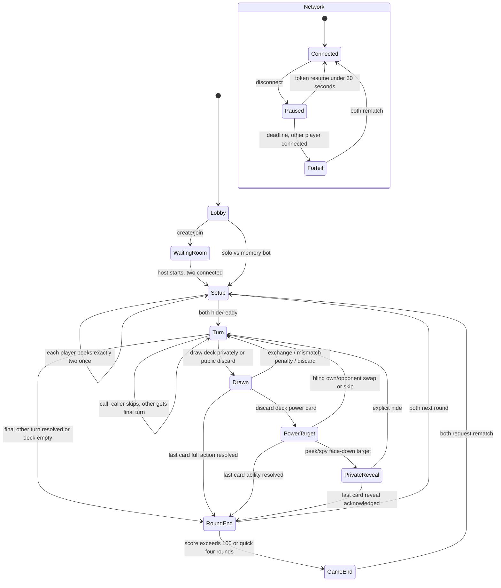

# User-visible statechart

The reducer is synchronous and pure. Animation completion is deliberately not an event. The engine cannot consume a draw while in a power target phase; illegal actions throw `RuleError` with stable codes. Transport treats reconnect/pause as an outer room state, so it cannot accidentally change hidden game state.

All hands use stable slot numbers, not face-down card IDs. Public events identify changed slots, never secret ranks. `viewFor` builds a fresh allowlisted object. Neither draw-pile order nor RNG seed is present in any multiplayer view.
